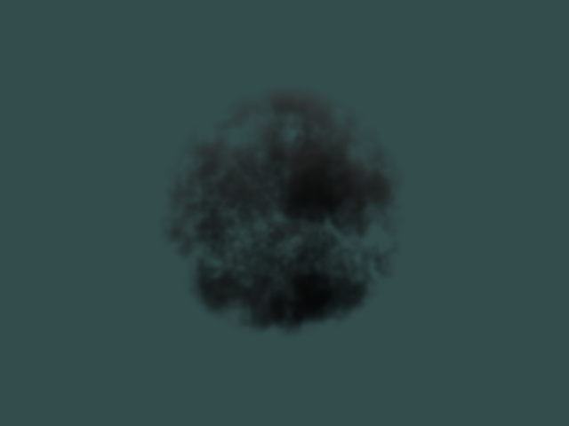
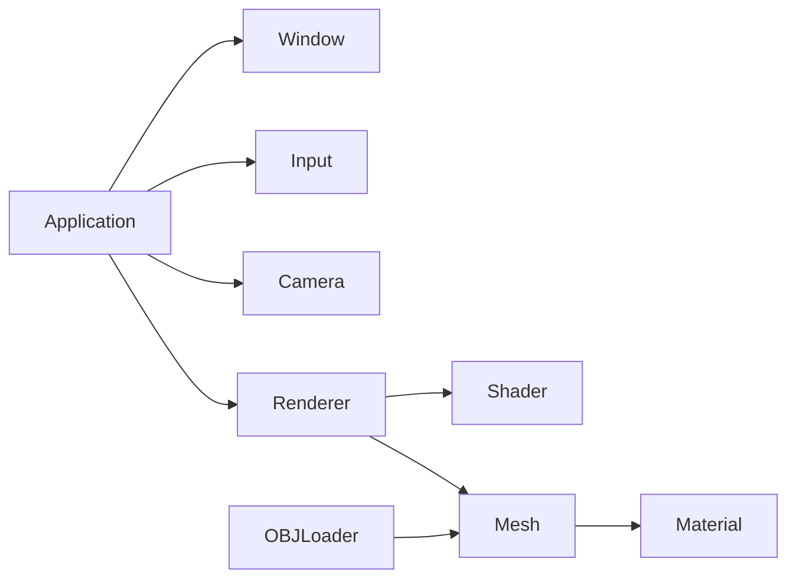

<!-- TODO(hero): add docs/media/hero.gif — a 5–10 s fly-through of the GPU volume in the running app (under 10 MB) — and show it here -->
<p align="center">
  
</p>

<h1 align="center">SmallEngine</h1>

<p align="center">
  <b>A small C++ / OpenGL renderer built from scratch to explore real-time volumetric rendering.</b><br>
  Ray-marched smoke with self-shadowing and anisotropic scattering — validated against a multithreaded CPU reference.
</p>

<p align="center">
  
  
  
  
  
  
</p>

---

## About

SmallEngine is a personal graphics project: a minimal engine layer (window, input, camera, meshes, materials) on top of raw OpenGL, used as a testbed for **participating media** — rendering smoke, fog and clouds by integrating light through a volume instead of shading a surface.

## Volumetric Rendering

The core of the project. The volume lives inside a unit cube; each fragment marches a ray through it in object space.

- **Ray–box intersection** in local space, so the camera can sit inside the volume
- **Beer–Lambert transmittance** with separate absorption and scattering coefficients (σₐ, σₛ)
- **Henyey–Greenstein phase function** for anisotropic (forward) scattering
- **Light marching** toward the light at every sample for volumetric self-shadowing
- **Interleaved gradient noise** jitter on the ray start to break up banding
- **Procedural density** from Perlin noise fBm (4 octaves) with a spherical falloff
- **Baked 3D density texture** — density is precomputed on the CPU into a 128³ `R32F` texture and sampled in GLSL

### CPU reference renderer

The same integrator is implemented in C++ and run on the CPU, split into row bands across all hardware threads, writing a PPM image. It's used to validate the GPU shader against a known-good result.

The image at the top of this page is that reference: 640×480, self-shadowed smoke lit from above, written by the integrator in [`src/renderer.cpp`](src/renderer.cpp). The GPU path is the same algorithm in [`resources/shaders/smoke.frag`](resources/shaders/smoke.frag), sampling the baked density texture.

## Engine



- **Application loop** with delta time: input → update → render
- **Renderer** abstraction for meshes, submeshes and volumes (depth/blend state handled per pass)
- **Mesh** with RAII GPU buffers, move semantics and per-material submeshes
- **OBJ + MTL loading** via tinyobjloader (ambient, diffuse, emission, dissolve, illum)
- **Free-fly camera** with mouse look
- **Input** with held/pressed key states, mouse delta and cursor lock

## Build & Run

Requirements: CMake 3.23+, a C++17 compiler, GLFW 3.4. Developed and tested on macOS (Apple Silicon); other platforms are on the roadmap.

```bash
# macOS
brew install cmake glfw

git clone https://github.com/alangutier24/SmallEngine.git
cd SmallEngine
cmake -S . -B build
cmake --build build
./build/Small_Engine
```

**Controls:** `WASD` move · `Q` / `E` down / up · Mouse look · `Esc` toggle cursor

## Roadmap

- [x] Engine core (window, input, camera, renderer)
- [x] OBJ/MTL loading with submeshes
- [x] Ray-marched volume with self-shadowing
- [x] CPU reference renderer
- [ ] Animated density on the GPU (3D noise in shader)
- [ ] Lighting for meshes (Blinn-Phong / PBR)
- [ ] Runtime parameter tweaking (ImGui)
- [ ] Windows / Linux support

## Built With

[GLFW](https://www.glfw.org/) · [GLAD](https://github.com/Dav1dde/glad) · [GLM](https://github.com/g-truc/glm) · [tinyobjloader](https://github.com/tinyobjloader/tinyobjloader) · [stb_image](https://github.com/nothings/stb)

## About the Developer

Built by **Alan Gutiérrez** — graphics & gameplay programmer.

[Portfolio](https://alangutier24.github.io/alangutierrezramirez/) · [GitHub](https://github.com/alangutier24) · [LinkedIn](https://www.linkedin.com/in/alan-gutierrez-ramirez-81379921b)
